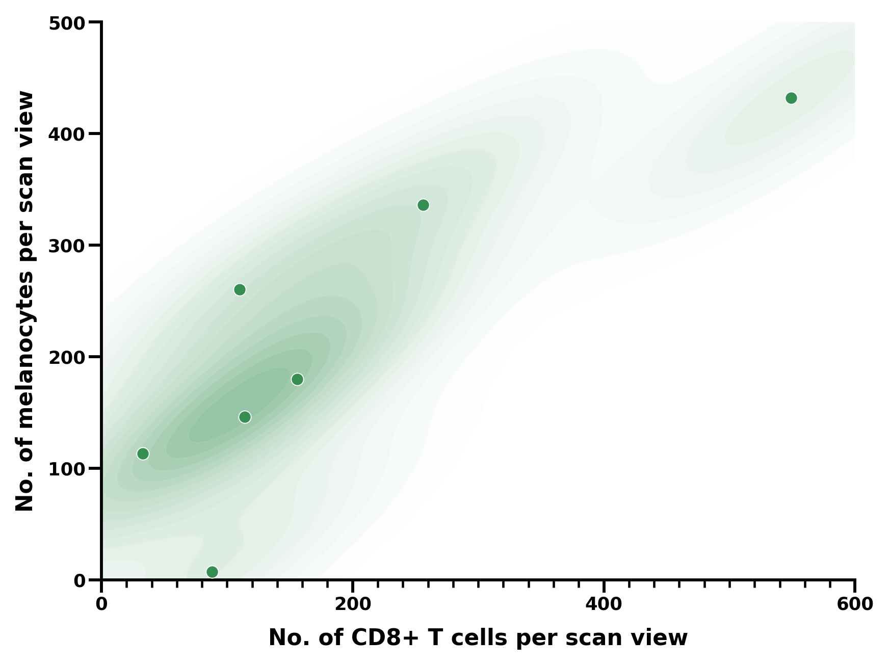

# CD8+T cell_melanocyte_density_cloud

[](https://github.com/misland4/CD8-T-cell_melanocyte_density_cloud/actions/workflows/ci.yml)

This repository contains `density_cloud.py`, the portable version of the original script `CD8+T_melanocyte_density_cloud_vector.py`. It visualizes the numbers of CD8+ T cells and melanocytes per scan view as two-dimensional kernel density estimate (KDE) clouds overlaid with scatter points.

Each point represents one paired observation: the horizontal coordinate is the CD8+ T-cell count and the vertical coordinate is the melanocyte count. The supplied research example contains **7 paired counts in one group**, displayed in dark green. The legacy two-group input additionally uses light green for its second group; these colors distinguish groups of paired observations.

The script exports PDF and PNG figures and also provides SVG output. The default PNG resolution is 300 dpi; PDF and SVG preserve vector contours and points.



## Contents

- [System requirements](#1-system-requirements)
- [Installation guide](#2-installation-guide)
- [Demo](#3-demo)
- [Instructions for use](#4-instructions-for-use)
- [Repository contents](#repository-contents)
- [Troubleshooting and support](#troubleshooting-and-support)
- [Data dictionary](docs/data.md)
- [Reproduction record](docs/validation.md)
- [Academic citation](#academic-citation)

## 1. System requirements

### Software dependencies and operating systems

Use **Python 3.13**. The exact tested dependencies are pinned in `requirements.txt`:

| Package | Tested version |
| --- | --- |
| NumPy | 2.3.5 |
| SciPy | 1.16.3 |
| Matplotlib | 3.10.6 |
| openpyxl | 3.1.5 |

### Methodology version and verified environment

The supplied original methodology notes specify **Python 3.14**. This repository's reproduction checks were performed with **Windows 11 Pro, Python 3.13.9** and the package versions listed above. The Python 3.14 and macOS test environments described in the notes have not been independently verified during this repository preparation.

The script uses portable Python libraries and includes command variants for Windows, macOS, and Linux. Only the Windows environment above has been tested for this release.

### Hardware

A standard desktop CPU is sufficient for these small inputs. No GPU, CUDA, or other non-standard hardware is required. The demo was timed on an Intel Core i5-14600KF desktop with approximately 32 GB RAM; this is the test machine, not a minimum hardware requirement.

## 2. Installation guide

### Windows PowerShell or CMD

```powershell
git clone https://github.com/misland4/CD8-T-cell_melanocyte_density_cloud.git
cd CD8-T-cell_melanocyte_density_cloud
python -m venv .venv
.venv\Scripts\python.exe -m pip install -r requirements.txt
```

Alternatively, download and extract the repository ZIP, enter its directory, and run the last two commands. No package activation is required.

### macOS/Linux command variant

```sh
python3 -m venv .venv
.venv/bin/python -m pip install -r requirements.txt
```

Use `.venv/bin/python` in place of `.venv\Scripts\python.exe` in the following commands.

**Measured installation:** creating a new Windows virtual environment took 3.4 seconds, and installing dependencies took 39.9 seconds in one run. Some wheels were cached; network speed and cache state affect these times. See the [reproduction record](docs/validation.md) for details.

## 3. Demo

### Research example

From the repository root, run:

```powershell
.venv\Scripts\python.exe density_cloud.py --input examples/research_density.xlsx --output-dir output
```

Expected files and console output on Windows:

```text
output\density_cloud.pdf
output\density_cloud.png
output\density_cloud.svg
```

The PNG is saved at 300 dpi. PDF and SVG retain vector contours and points. The preview above is generated from this workbook and plots exactly seven observations in a single dark green cloud. Output files with the same names are overwritten on subsequent runs.

**Measured runtime:** about **1.4 seconds** for the research example and all three output formats in one run on the test desktop, with dependencies already installed. This is a single-run observation, not a benchmark across machines.

### Data provenance

[Download the included research workbook](examples/research_density.xlsx). It is a byte-for-byte copy of the supplied `Simulated dataset to demo the code.xlsx`, with a simpler repository filename. The dataset provider confirmed that these are **real research observations**. The original worksheet name, `Simulated dataset`, is retained; the wording in that source name does not reflect the provider's confirmation.

The source workbook is not rewritten. The script reads `B2:C8` from that worksheet and preserves all seven numeric pairs and their order. No second group is inferred or generated.

## 4. Instructions for use

### Use your own workbook

```powershell
.venv\Scripts\python.exe density_cloud.py --input "C:/data/counts.xlsx" --sheet "Sheet1" --output-dir "C:/data/figures"
```

`--input` is required. `--sheet` selects a worksheet by name; otherwise the active worksheet is read. `--output-dir` defaults to `output/` next to the script. The script does not search neighboring folders for input files.

### Preferred input layout

| Excel location | Meaning |
| --- | --- |
| B1 | Header: `CD8+ T cells` |
| C1 | Header: `Melanocyte` (or `Melanocytes`) |
| B2:B... | CD8+ T-cell counts per scan view |
| C2:C... | Corresponding melanocyte counts per scan view |

Column A is unused. Each row is one paired `(CD8+ T cells, melanocytes)` observation; all rows after the headers are read as one group. Completely blank rows are skipped; half-empty rows are rejected. At least three finite, non-negative, non-collinear points are required for 2D KDE. Use numeric cells; formulas require cached numeric results saved by a spreadsheet application.

### Legacy two-group layout

The original two-group layout remains supported when the preferred B1/C1 headers are absent:

| Excel cells | Meaning |
| --- | --- |
| D17:E23 | First group: CD8+ T-cell counts / melanocyte counts |
| D24:E30 | Second group: CD8+ T-cell counts / melanocyte counts |

`examples/synthetic_density.xlsx` is the earlier, explicitly synthetic example of that legacy layout. It is separate from the supplied research workbook:

```powershell
.venv\Scripts\python.exe density_cloud.py --input examples/synthetic_density.xlsx --output-dir output_synthetic
```

### Plot conventions and reproduction

- x axis: **No. of CD8+ T cells per scan view**; range 0–600.
- y axis: **No. of melanocytes per scan view**; range 0–500.
- The single research group uses the original dark green color and KDE bandwidth 0.58. The optional legacy second group uses light green and bandwidth 0.64.
- Each cloud is normalized to its own maximum and uses a cutoff of 0.04. Intensity shows within-group relative density rather than comparable absolute density between groups.
- Counts outside the original axis ranges are rejected so observations cannot disappear silently. Adjust the ranges and KDE grid in the code if larger limits are needed.

To reproduce the repository preview, run the research demo with the pinned dependencies. No random values are added to the data.

### Checks

```powershell
.venv\Scripts\python.exe -m unittest discover -s tests -v
```

The checks use Python's built-in `unittest`; `pytest` is not required.

## Repository contents

| Path | Purpose |
| --- | --- |
| `density_cloud.py` | Plotting command-line script |
| `examples/` | Research workbook and separate historical examples |
| `docs/data.md` | Data fields, provenance and interpretation limits |
| `docs/validation.md` | Independent installation/test record |
| `tests/` | Input-validation and complete-output checks |
| `.github/workflows/ci.yml` | Automated tests and demo generation |
| `requirements.txt` | Pinned direct dependencies |
| `requirements-windows-py313.lock.txt` | Complete tested Windows environment |
| `CITATION.cff` | Software citation |
| `CHANGELOG.md` | Version history |

## Troubleshooting and support

- **Wrong input:** check paths, Excel layout and exact column headers. Use `--sheet` to select a worksheet by name.
- **Missing/non-numeric values:** provide both values per row. Recalculate and save Excel formulas so cached numeric results exist.
- **Cannot write outputs:** close files held open by other applications, or choose a writable `--output-dir`.
- **Installation errors:** select Python 3.13 and install this repository's requirements. See the [tested environment](docs/validation.md).
- **Plot/input constraints:** A group needs at least three non-collinear points for KDE; counts must be inside x = 0–600 and y = 0–500.

Use [GitHub Issues](https://github.com/misland4/CD8-T-cell_melanocyte_density_cloud/issues) to report reproducible problems; see [CONTRIBUTING.md](CONTRIBUTING.md). Known data fields and scientific context still needed from the authors are described in [docs/data.md](docs/data.md).

## Version and validation

Current software version: **1.0.0**. See [CHANGELOG.md](CHANGELOG.md) and [Releases](https://github.com/misland4/CD8-T-cell_melanocyte_density_cloud/releases) for fixed versions. Local clean-environment checks passed. The badge above links to automated checks; consult each platform job for actual passing results.

## Authors

Project creators and lead maintainers:

- Chunying Li, Email: <lichying@fmmu.edu.cn>
- Yinghan Wang, Email: <wang.yinghan@qq.com>

## Credits

We would like to thank Shuo Yang for his assistance with this project.

## Academic citation

Please cite the software using [CITATION.cff](CITATION.cff), or GitHub's **Cite this repository** panel:

Li, C., & Wang, Y. (2026). *CD8+ T-cell and melanocyte density cloud* (Version 1.0.0) [Computer software]. https://github.com/misland4/CD8-T-cell_melanocyte_density_cloud

The associated research-paper citation has not yet been supplied; no article DOI is assumed.

## License

The project contact has confirmed permission to reuse the code and data. The authors have not yet specified a named license or its scope, so no standard license file has been selected. This statement does not assign additional license terms; formal licensing will be added after author confirmation.
